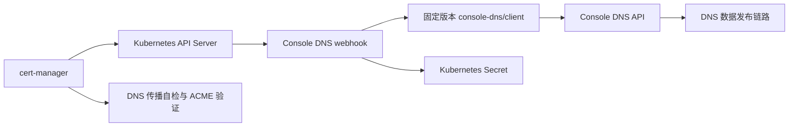

本文件保留 `github.com/console-dns/client-webhook-cert-manager` 的实现前评估。后续已按用户要求实施 webhook、DNS API TLS 配置、OCI Helm chart 和 GitHub Actions；实际安装与配置以 [README](../README.md) 和源码为准。下文的“拟定”“建议”和测试状态描述记录的是评估阶段，不是当前交付状态。

评估日期：2026-11-13。Go module 路径和客户端版本均按用户指定：

```go
module github.com/console-dns/client-webhook-cert-manager

require github.com/console-dns/client v0.0.0-20250418013039-135fd950cbe2
```

以上是依赖约束片段，尚不是可构建的完整 go.mod。客户端来源为提交 `135fd950cbe254d73d3e61f65ff9a242a4f4033f`；其 spec 依赖为 `v0.0.0-20250418012353-b2bd63df99d1`。实施中保留这两个版本，不通过升级、fork 或 replace 改变指定客户端的行为。[客户端依赖声明](https://github.com/console-dns/client/blob/135fd950cbe254d73d3e61f65ff9a242a4f4033f/go.mod)

评估结论：可以基于指定客户端实现 cert-manager 外部 DNS01 webhook。核心功能所需的区域读取、TXT 创建和删除均已具备；生产可用性有条件，尤其取决于实际部署的 Console DNS 服务端版本。本次同时核查的公开服务端提交 `93861e131648a33a6688eb66b766fa73cbe3b840` 存在并发读写未加锁、变更主要在退出时持久化的问题，客户端适配层不能完整解决这些后端问题。当前结论不代表已通过端到端签发测试。

项目采用 Go，运行于 Kubernetes，通过聚合 APIService 接入 cert-manager。使用官方 webhook 服务框架，实现 `Name`、`Initialize`、`Present`、`CleanUp`，发行 Docker 镜像及 Helm chart。官方推荐外部 DNS provider 以 webhook-example 为基础。[开发文档](https://cert-manager.io/docs/contributing/dns-providers/)、[官方示例](https://github.com/cert-manager/webhook-example)



webhook 负责写入和清理验证 TXT；证书申请、续期、DNS 传播自检和证书 Secret 由 cert-manager 管理。API 写入成功与 DNS 权威服务器实际可查询到记录是两个验收点。[DNS01 文档](https://cert-manager.io/docs/configuration/acme/dns01/)

客户端已确认的接口如下。请求使用 `Authorization: Bearer <token>`，TXT JSON 为 `{"ttl": 60, "text": "<challenge-key>"}`。其中 60 秒是本项目建议默认 TTL，需在目标环境确认。

| 本项目操作 | 指定客户端方法 | HTTP 接口 |
| --- | --- | --- |
| 查询目标区域与现有 TXT | `ListZone(zone)` | `GET /api/v1/zones/{zone}` |
| 创建一个 TXT 值 | `CreateRecord(zone, name, "TXT", record)` | `POST /api/v1/zones/{zone}/{name}/TXT` |
| 删除一个匹配 TXT | `DeleteRecord(zone, name, "TXT", record)` | `POST /api/v1/zones/{zone}/{name}/TXT/delete` |

`ListZones`、`UpdateRecord` 虽存在，首版主流程无需调用。按已解析的 zone 读取可减少全量区域查询。所有 DNS API 调用继续经过指定客户端。[客户端实现](https://github.com/console-dns/client/blob/135fd950cbe254d73d3e61f65ff9a242a4f4033f/client.go)

DNS 名称转换使用 `ChallengeRequest.ResolvedFQDN`、`ResolvedZone` 和 `Key`。直接将 `Key` 写入 TXT，不重复计算摘要，不额外添加 DNS 展示格式中的引号。Secret 从 `ResourceNamespace` 获取；对于 Issuer，该值是 Issuer 命名空间；对于 ClusterIssuer，该值是 cert-manager 配置的 cluster resource namespace。[ChallengeRequest 定义](https://github.com/cert-manager/cert-manager/blob/v1.21.3/pkg/acme/webhook/apis/acme/v1alpha1/types.go)

例如 `ResolvedFQDN=_acme-challenge.www.example.com.`、`ResolvedZone=example.com.`，转换为 API 参数 `zone=example.com`、`name=_acme-challenge.www`。比较时规范化大小写和末尾根点，并按 DNS 标签边界检查归属，避免将 `badexample.com` 错认作 `example.com` 的子域。服务端 zone 查找使用区分大小写的 map，建议部署中统一使用小写 zone；历史混合大小写配置需要另行确认。zone 不匹配时明确报错，首版不自动尝试向父 zone 写入。

当前公开服务端拒绝带末尾点的 zone，记录名不会自动从 FQDN 转成相对名称，且 `@` 与空记录名均不能通过其校验。因此，FQDN 恰好等于 zone 的委派至区域根场景，首版应明确报“不支持目标区域根记录”，直到实际后端的根记录表示获得验证。常规域名和通配符证书使用 `_acme-challenge` 相对记录，不受这个特殊限制影响；多标签相对名称也需通过实际 DNS 发布链路验证。[服务端名称校验](https://github.com/console-dns/server/blob/93861e131648a33a6688eb66b766fa73cbe3b840/pkg/utils/regexp.go)

启用 CNAME 委派时，由用户在 Issuer 中设置 `dns01.cnameStrategy: Follow`；webhook 使用 cert-manager 解析后的目标，不从原始 `DNSName` 重新拼接。未启用时保持 cert-manager 的默认策略。[CNAME 委派说明](https://cert-manager.io/docs/configuration/acme/dns01/#delegated-domains-for-dns01)

`Present` 的拟定流程：

1. 校验配置、目标 zone/name 和 Secret 引用，读取 token，创建本次调用使用的客户端实例。
2. 调用 `ListZone`，定位目标名称的 TXT 集合。
3. 如果已存在 `Text == ch.Key` 的记录，认为目标已满足并返回成功；不因 TTL 不同再次插入相同验证值。
4. 如果不存在，追加 `RecordTXT{Ttl: configuredTTL, Text: ch.Key}`，保留同名其他 TXT。
5. 对写入结果进行有界读取确认。写请求发生网络错误或重复冲突时，先确认目标状态；仅在已满足目标时视为成功，其余返回可诊断错误，交由 cert-manager 后续重试。401/403 等认证授权错误直接返回。

`CleanUp` 的拟定流程：

1. 读取目标名称现有 TXT，只选择 `Text == ch.Key` 的记录。
2. 使用读取结果中的真实 `Ttl` 和 `Text` 调用 `DeleteRecord`；如果出现同一个 key 对应多个 TTL 的遗留记录，逐一删除这些匹配项。
3. 可确认不存在时返回成功，保证重复清理可接受。发生删除冲突或结果不确定时重读确认；不将所有 400、404、空响应或权限错误统一解释为清理完成。尤其不能仅凭权限过滤后的空读取判定不存在。
4. 保留其他 challenge 的 TXT 值，也保留该名称上的其他记录类型。清理不依赖进程内保存的创建状态，以支持 Pod 重启后重试。

此处必须区分客户端模型与服务端执行语义。固定 spec 的 `IndexTXT` 同时比较 `Text` 和 `Ttl`，`ModTXT` 会拒绝重复记录；但客户端的 Create/Delete 仅序列化对象并发送请求，不调用这些模型匹配方法。当前公开服务端已使用自己的模型：创建直接追加，删除只按 `Text` 移除第一条，TTL 仍必须能够解析。客户端模型不能证明部署中的服务端采用相同匹配规则。[固定 spec 的 TXT 逻辑](https://github.com/console-dns/spec/blob/b2bd63df99d1e6ead8c4e58f3a2c222b7cf482de/models/txt.go)、[当前服务端 TXT 逻辑](https://github.com/console-dns/server/blob/93861e131648a33a6688eb66b766fa73cbe3b840/pkg/models/zones/spec.go#L772)

读取服务端真实 TTL 再删除，是兼容两类行为的保守策略。清理还需要处理同一个 key 的重复副本；使用有界循环读取并删除，超出上限则返回错误供后续重试，不承诺一次调用无限清理。并发期间检查后创建仍有竞争窗口，无法仅靠预查询实现严格 exactly-once。

服务端审阅结果直接影响上线条件：

| 当前公开服务端的代码事实 | 对 webhook 的影响 | 所需处理或验证 |
| --- | --- | --- |
| TXT 创建会追加重复值，删除只去掉第一条同 Text 记录 | 响应丢失后重试可能留下多个相同 key | 创建前检查，写后核对，清理有界删除所有同 key 副本 |
| GET zone 按 token 过滤；存在的 zone 无可读记录时返回 `200 null` | “记录不存在”和“目标不可读”可能无法从查询结果区分 | token 必须对目标名称的 TXT 具备 `rw`；明确验证权限与缺失错误契约 |
| 写入允许 `ru`/`rw`，删除要求 `rw` | `ru` token 能申请但不能清理 | 使用针对目标 TXT 的 `rw` 规则，覆盖实际 CNAME 委派目标 |
| 共享 map/slice 的 GET、POST、DELETE 未见应用层锁 | 并发请求有数据竞争、丢更新或进程异常风险 | 对实际部署做并发验证；若运行该实现，后端需要补齐同步，单副本 webhook 不能完整保证并发安全 |
| 请求修改内存，主要在退出时 Flush，且保存错误存在被忽略的路径 | HTTP 200 不能证明重启后记录状态保持，清理可能在异常重启后回退 | 验证新增、删除、崩溃及重启后的状态，后端需要可靠持久化 |

以上事实分别来自[API 读取与变更处理](https://github.com/console-dns/server/blob/93861e131648a33a6688eb66b766fa73cbe3b840/pkg/services/zones/apis.go)、[token 权限定义](https://github.com/console-dns/server/blob/93861e131648a33a6688eb66b766fa73cbe3b840/pkg/models/clients/rule.go)、[退出时 Flush](https://github.com/console-dns/server/blob/93861e131648a33a6688eb66b766fa73cbe3b840/pkg/content/spec.go#L77)、[zone 存储实现](https://github.com/console-dns/server/blob/93861e131648a33a6688eb66b766fa73cbe3b840/pkg/models/zones/zones.go)。它们属于该提交的静态审阅结果，并不代表用户实际部署版本已经被检查。

对空读取结果，客户端反序列化 `null` 后会得到缺少 Records 的 Zone，无法恢复被服务端过滤的信息。要同时保证重复 CleanUp 和权限错误可见，需要先核实目标版本契约：例如当前服务端删除先校验删除权限，随后对目标不存在返回特定 400 错误，可以通过一次删除检查区分 403 与明确缺失。若采用这一策略，缺失错误分类必须限定到已验证的服务端版本和精确错误，未知 400 保留为错误；不能仅用空视图作为幂等成功依据。该部分必须纳入契约测试。[服务端删除处理](https://github.com/console-dns/server/blob/93861e131648a33a6688eb66b766fa73cbe3b840/pkg/services/zones/apis.go#L167)

本项目采用的配置草案如下，尚未实现。`groupName` 必须在 Helm、运行参数、APIService 和 Issuer 中完全一致；此处使用 `acme.console-dns.github.com` 作为可配置的初始建议。`solverName` 建议固定为 `console-dns`。[webhook 配置约定](https://cert-manager.io/docs/configuration/acme/dns01/webhook/)

```yaml
apiVersion: cert-manager.io/v1
kind: ClusterIssuer
metadata:
  name: console-dns-staging
spec:
  acme:
    email: admin@example.com
    server: https://acme-staging-v02.api.letsencrypt.org/directory
    privateKeySecretRef:
      name: console-dns-staging-account
    solvers:
      - selector:
          dnsZones:
            - example.com
        dns01:
          webhook:
            groupName: acme.console-dns.github.com
            solverName: console-dns
            config:
              server: https://dns-api.example.com
              tokenSecretRef:
                name: console-dns-api-token
                key: token
              ttl: 60
```

token 通过 Kubernetes Secret 引用，不直接写入 Issuer。每次操作读取 Secret，支持后续 token 轮换，不共享可变 token 的全局客户端。首版 Secret 引用仅包含 name/key，不提供任意 namespace 参数。安装配置为指定 Secret 命名空间与名称生成 `get` 权限的 Role/RoleBinding，并为 webhook 框架配置聚合 API 所需的认证委托权限。不得以一个全局 token 自动替代缺失的 Secret 引用。

指定客户端版本的局限和拟定处理如下。

| 已确认的局限 | 影响 | 保持指定版本时的处理 |
| --- | --- | --- |
| 使用 `http.DefaultClient`，未设置总超时 | DNS API 异常时调用可能长时间阻塞 | 在进程启动、并发服务开始前，一次性配置带总超时的默认 HTTP client；建议默认 10 秒，作为进程级参数 |
| 不接受 `context.Context`，不能注入实例级 HTTP client | 不能完整透传调用取消；无法直接提供每个 Issuer 独立的 HTTP transport/超时 | 明确首版限制；总超时限制单次调用，操作内控制请求次数；不使用仅超时返回但留下后台请求的 goroutine 包装 |
| 忽略 `http.NewRequest` 的错误 | 非法 URL 可能触发 panic | 在调用 SDK 前验证 scheme、host、路径和 token 格式，规范化末尾斜杠，拒绝 userinfo/query/fragment 等不支持的 URL 形式 |
| 忽略 `io.ReadAll` 的错误；只有 HTTP 200 被视为成功 | 读入失败或不同成功状态码可能导致误判 | 契约测试覆盖完整/截断响应；用实际读取状态核对变更结果；保留 HTTP 状态用于诊断 |
| 错误主要是响应正文，缺少稳定业务错误类型 | 相同 400 可能代表不同业务失败，难以跨服务端版本可靠分类 | 优先结合状态码和读回状态；对空视图的缺失判断使用经过契约验证的有限分类，不吞掉未知错误；限制、清理对外错误内容 |
| 没有路径参数编码 | 异常路径字符可能改变路由 | 只接受经过 DNS 名称规范化和验证的 zone/name，TXT 值仅进入 JSON body |

修改 `http.DefaultClient` 是进程级兼容措施，会影响进程内其他使用默认 client 的代码；初始化后不再改动，测试中检查其影响。此措施不能补齐 SDK 的请求级取消能力。固定依赖的限制应保留在 README 中。[HTTP 实现依据](https://github.com/console-dns/client/blob/135fd950cbe254d73d3e61f65ff9a242a4f4033f/client.go)

版本方面，客户端自身声明 Go 1.24.2；本次读取的官方 cert-manager v1.21.3 声明 Go 1.26.0，并使用 Kubernetes Go 库 v0.36.2。若采用该版本作为实现基线，项目 Go 版本至少为 1.26.0，Kubernetes 库随 cert-manager 对齐。官方示例当前 HEAD 的依赖已更新到另一组 Kubernetes 库，不能直接将其 go.mod 当作兼容性保证。最终支持的集群版本需要通过测试明确。[cert-manager v1.21.3 依赖](https://github.com/cert-manager/cert-manager/blob/v1.21.3/go.mod)、[本次审阅的示例依赖](https://github.com/cert-manager/webhook-example/blob/598509172c9f192cd559571b2e3f34585af0e796/go.mod)

建议首版交付以下文件与能力，目录目前仅为设计：

```text
cmd/webhook/main.go                 启动、进程参数和 HTTP 初始化
internal/solver/                    配置、Secret、DNS 名称转换及生命周期
internal/provider/                  指定客户端的薄适配层与状态核对
deploy/client-webhook-cert-manager/ Helm chart
examples/                          Issuer、ClusterIssuer、Secret、Certificate 示例
testdata/                          测试配置
Dockerfile
Makefile
go.mod / go.sum
README.md
```

Helm chart 包含 Deployment、Service、ServiceAccount、APIService、RBAC，以及供 webhook HTTPS 服务使用的 CA/Certificate。服务证书通过 SelfSigned/CA Issuer 生成，避免启动过程依赖本 DNS01 solver。提供 readiness/liveness 探针、资源配置和非 root 运行设置；首版单副本起步，多副本的正确性依赖服务端并发与持久化验证，不用 Pod 内互斥锁替代后端并发保证。[官方部署模板](https://github.com/cert-manager/webhook-example/tree/598509172c9f192cd559571b2e3f34585af0e796/deploy/example-webhook/templates)

验收应覆盖实际故障边界：

| 层次 | 必须覆盖的结果 |
| --- | --- |
| 单元测试 | 名称转换、暂不支持的区域根目标报错、子域边界、CNAME 目标、缺失配置、Secret namespace 与 key、TXT 值无额外引号 |
| SDK 契约测试 | 使用本地 httptest HTTP 服务验证路径、Bearer、JSON、200/4xx/5xx、超时、截断响应，不调用生产 DNS |
| 生命周期测试 | 重复 Present、重复 CleanUp、同名两个 key 共存、相同 key 重复副本、TTL 变化后的清理、并发冲突、200 null/权限过滤、Pod 状态丢失后清理 |
| Helm 与 API 接入 | lint/template、TLS、CA 注入、APIService Available、cert-manager 调用权限、Secret 最小权限 |
| 官方 ACME solver 测试 | 按固定 cert-manager 版本的测试套件运行基础及扩展用例 |
| 后端验证 | 并发读写与 race 检查、写入/清理后服务端异常退出与重启、权限规则变更、持久化失败 |
| 端到端 | 在授权测试区域通过 ACME staging 签发普通/通配符证书，观察 DNS 发布、清理及续期流程 |

客户端仓库的现有测试使用固定本地服务，且操作 A 记录，不能作为 TXT webhook 正确性的依据。本次仅在临时客户端检出中执行 `go test -run '^$' ./...`，编译通过，未执行测试函数；没有运行其真实服务测试。上述 webhook 测试均为后续实施的验收计划。[客户端现有测试](https://github.com/console-dns/client/blob/135fd950cbe254d73d3e61f65ff9a242a4f4033f/client_test.go)

实施顺序建议为：先完成配置/Secret/名称转换和本地 HTTP 契约测试，再完成幂等 Present/CleanUp 与故障用例，随后交付 Helm 和镜像，最后在指定测试区域验证实际签发。首版范围是一个 provider 的 DNS01 webhook、部署材料和使用文档。

目前已固定 module 路径和客户端版本。审阅重点是标准 webhook 形态、固定 SDK 的进程级 HTTP 超时方案，以及目标 cert-manager/Kubernetes 和 Console DNS 服务端版本。服务端地址、测试 zone 和目标 TXT 的 `rw` token 权限可在真实环境联调前准备，不妨碍先完成本地实现和契约测试。groupName、TTL 与超时默认值仍属于可审阅的配置建议。
